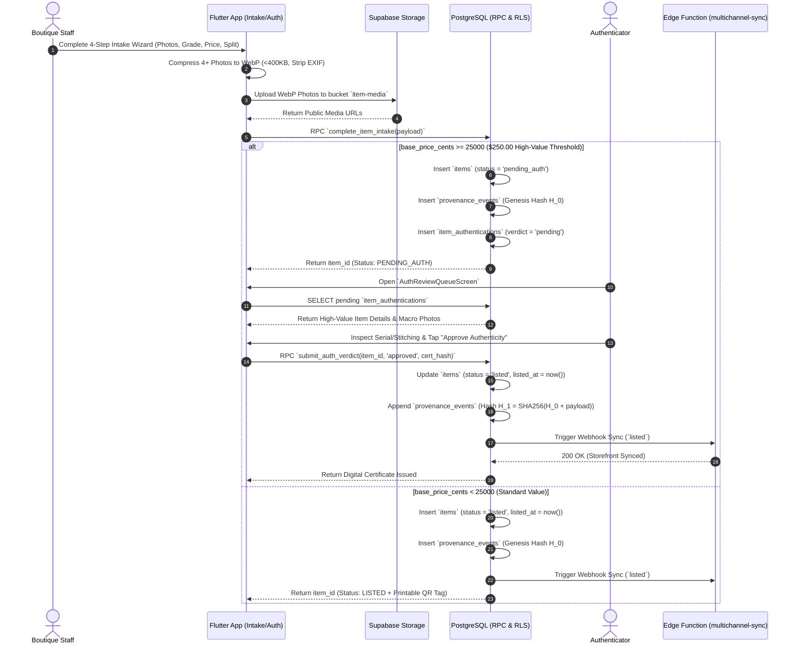
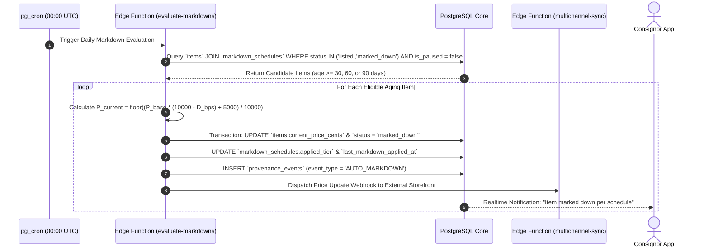
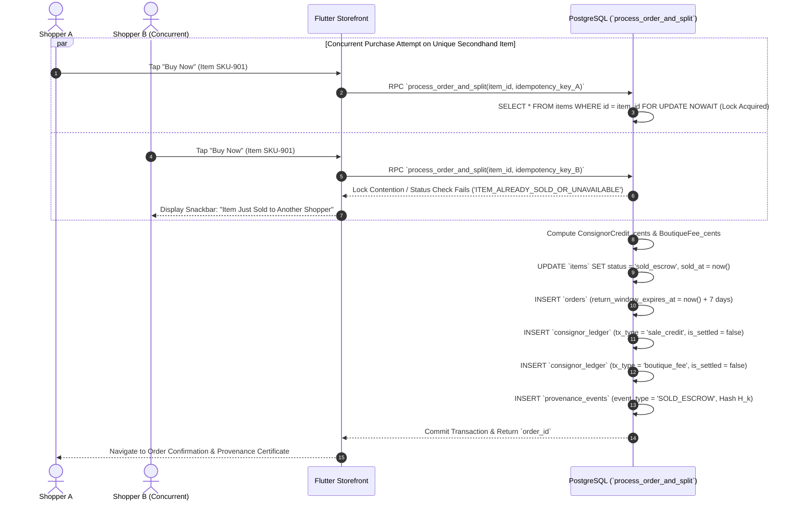
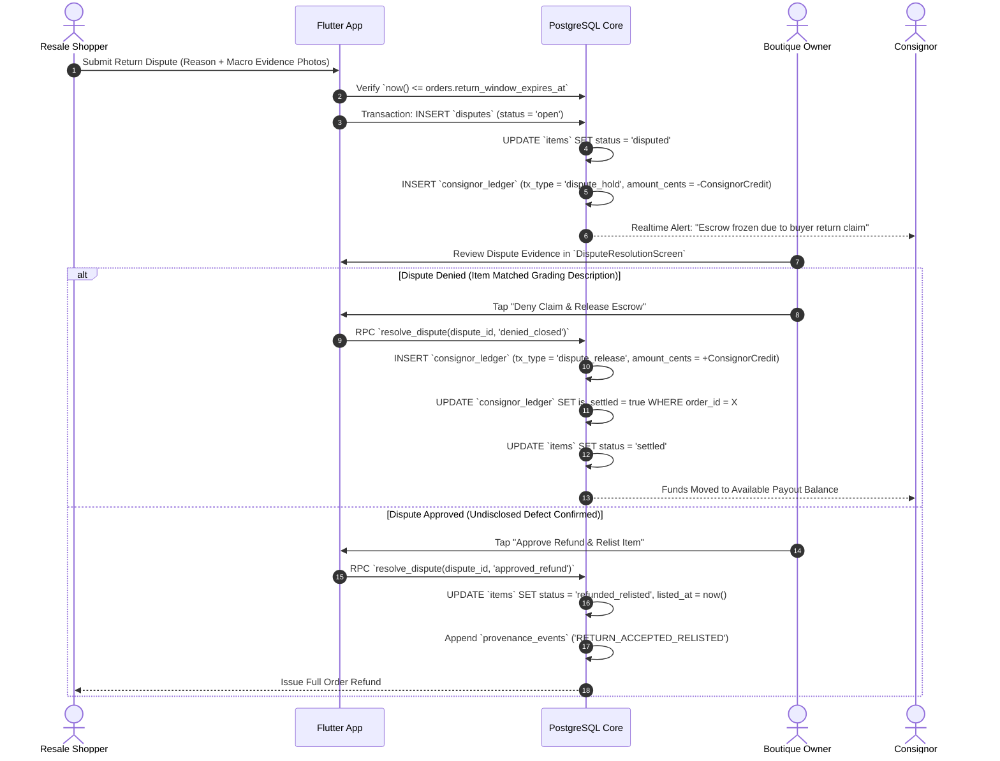
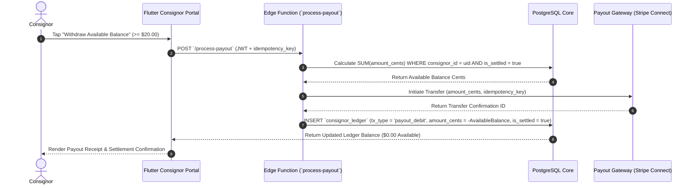

# 09 — Sequential Design Diagrams: ResaleRoute

## 1. Item Intake & Conditional High-Value Authentication Sequence

This sequence illustrates how an item is graded by boutique staff, evaluated against the boutique's high-value threshold ($\$250.00$), verified by a third-party authenticator, and automatically published to external channels.

---

## 2. Automated Aging Markdown Cron Sequence

This sequence details the daily `00:00 UTC` scheduled job that evaluates unsold inventory age ($30, 60, 90\text{ days}$) and applies basis-point price reductions.

---

## 3. Checkout, Pessimistic Locking & Double-Entry Split Ledger Sequence

This sequence shows how concurrent purchases are serialized via `FOR UPDATE NOWAIT` and how revenue is split into unsettled escrow ledger entries.

---

## 4. Return Dispute & Escrow Freeze Sequence

This sequence covers what happens when a shopper files a return dispute within the 7-day escrow window and how the boutique owner resolves it.

---

## 5. Consignor Payout Settlement Sequence

